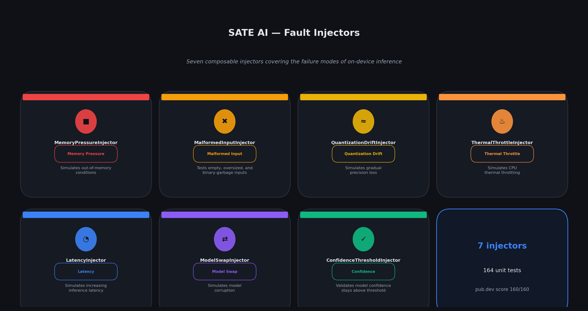
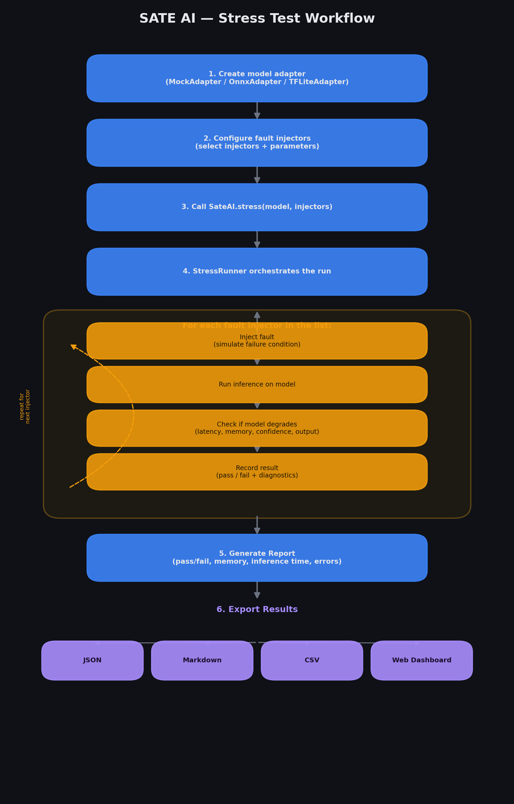

# SATE AI

Fault Injection Framework for On-Device AI Models in Flutter

[](https://pub.dev/packages/sate_ai)
[](https://pub.dev/packages/sate_ai/score)
[](https://pub.dev/packages/sate_ai/score)
[](https://github.com/assassinaj602/sate_ai/stargazers)
[](https://github.com/assassinaj602/sate_ai/actions)
[](https://opensource.org/licenses/MIT)
[](https://flutter.dev)

> 📄 **Published research:** Three papers published on Zenodo cover SATE AI and on-device AI reliability:
> 1. **SATE AI Framework Paper:** [DOI: 10.5281/zenodo.23250418](https://doi.org/10.5281/zenodo.23250418)
> 2. **EdgePulse Telemetry Paper:** [DOI: 10.5281/zenodo.23248718](https://doi.org/10.5281/zenodo.23248718)
> 3. **Joint Fault Injection & Tracing Study:** [DOI: 10.5281/zenodo.23262270](https://doi.org/10.5281/zenodo.23262270) (280 real-device traces across TFLite, ONNX, and GGUF)

## Architecture

SATE AI is organized into two packages:

- `sate_core` — pure Dart core (fault injectors, adapters, reports). No Flutter dependency.
- `sate_ai` — Flutter package wrapping `sate_core`, plus native adapters (ONNX, TFLite, Fllama).

The CLI (`dart pub global activate sate_ai`) uses only `sate_core` at runtime — Flutter is not required.

## Overview

SATE AI is a fault injection framework for testing on-device AI models in
Flutter and Dart. It simulates real-world failure scenarios — memory pressure,
malformed inputs, quantization drift, thermal throttling, latency, model
corruption, network failure, GPU memory pressure, and confidence degradation —
so developers can validate model reliability before shipping to production.

## Features

- 11 fault injectors covering memory, I/O, thermal, and network failure modes
- Model Quantization Analyzer for ONNX and TFLite models
- 8 model adapters: MockAdapter, OnnxAdapter, TFLiteAdapter, FllamaAdapter,
  MediaPipeAdapter, CoreMLAdapter, GoogleMLKitAdapter, and custom adapters
- CLI tool with subcommands for stress, benchmark, batch, schedule, serve,
  health-check, badge, template output, and quantization analysis
- HTML report export with Chart.js charts
- Real-time SSE monitoring dashboard
- Golden baseline regression detection
- Stress test retries and flaky test detection
- SQLite storage for historical report tracking
- CI/CD status badges (SVG)
- Custom report templates (JSON/YAML)
- Retry and flaky test detection
- Stress scheduler (cron)
- VS Code extension

## Installation

### CLI (no Flutter required)

The CLI can be installed with only the Dart SDK:

```bash
dart pub global activate sate_cli
sate_ai --model model.gguf --injectors memoryPressure
```

If `sate_ai` is not found after install, add the pub cache to your PATH:

```bash
export PATH="$PATH:$HOME/.pub-cache/bin"
```

### Flutter package

Add to your `pubspec.yaml`:

```yaml
dependencies:
  sate_ai: ^0.13.0
```

```bash
flutter pub get
```

### Flutter developers who want both

If you already have Flutter installed and want the CLI alongside the package:

```bash
flutter pub global activate sate_ai
```

| Placeholder | Description |
|-------------|-------------|
| `{{ model }}` | Model ID |
| `{{ passed }}` | true/false |
| `{{ passed_emoji }}` | PASS/FAIL |
| `{{ total_tests }}` | Total test count |
| `{{ passed_count }}` | Passing tests |
| `{{ failed_count }}` | Failing tests |
| `{{ duration_ms }}` | Duration in ms |
| `{{ start_time }}` | ISO8601 start time |
| `{{ end_time }}` | ISO8601 end time |
| `{{ results }}` | Formatted results list |
| `{{ failures }}` | Formatted failures list |
| `{{ memory_mb }}` | Peak memory usage |

## CI/CD Status Badges

Generate SVG badges for your stress test results to include in your project README or CI pipeline artifacts:

```bash
# Generate default status badge (PASS/FAIL)
sate_ai --model model.gguf --badge badge.svg

# Generate specific badge types: status, latency, memory, tests
sate_ai --model model.gguf --badge latency.svg --badge-type latency
sate_ai --model model.gguf --badge memory.svg --badge-type memory
sate_ai --model model.gguf --badge tests.svg --badge-type tests
```

### Programmatic Badge Generation

```dart
final report = await SateAI.stress(model: myModel, injectors: injectors);

// Generate SVG string
final svgStatus = report.toBadge(type: BadgeType.status);
final svgLatency = report.toBadge(type: BadgeType.latency);

// Write SVG badge to file
await report.writeBadgeToFile('assets/badges/status.svg', type: BadgeType.status);
```

| Badge Type | CLI Flag | Example |
|------------|----------|---------|
| Status | `--badge-type status` | `SATE AI \| PASS` |
| Latency | `--badge-type latency` | `stress duration \| 120ms` |
| Memory | `--badge-type memory` | `peak memory \| 145.0MB` |
| Tests | `--badge-type tests` | `stress tests \| 5/5 passed` |

## SQLite Historical Report Storage

SATE AI includes a cross-platform SQLite database (`ReportDatabase`) powered by `sqflite_common_ffi` to store and query historical stress reports over time.

### CLI Usage

Save reports to SQLite database during a stress test run:

```bash
# Save report to custom SQLite database file
sate_ai --model model.gguf --db reports.db
```

Query stored historical reports:

```bash
# View all recent historical reports stored in SQLite database
sate_ai --db-history all --db reports.db

# View reports specifically for a model ID
sate_ai --db-history llama-7b --db reports.db
```

### Programmatic API Usage

```dart
import 'package:sate_ai/sate_ai.dart';

Future<void> main() async {
  final db = ReportDatabase('sate_ai_reports.db');
  await db.open();

  // Save report to database
  final rowId = await db.insertReport(report);
  print('Saved report #$rowId');

  // Query recent 10 reports
  final recentReports = await db.queryRecent(limit: 10);

  // Filter reports by model ID
  final llamaReports = await db.queryByModel('llama-7b');

  // Filter reports by date window
  final rangeReports = await db.queryByDateRange(
    from: DateTime.now().subtract(const Duration(days: 7)),
    to: DateTime.now(),
  );

  // Count total reports stored
  final total = await db.count();
  print('Total historical reports: $total');

  await db.close();
}
```

### ReportDatabase API Reference

| Method | Description |
|---|---|
| `open()` | Opens the database file and initializes schema |
| `close()` | Closes active SQLite connection |
| `insertReport(report)` | Stores a `StressReport` and returns the new row ID |
| `queryRecent({limit})` | Returns recent `StressReport` list ordered by `start_time DESC` |
| `queryByModel(modelId)` | Returns reports matching the specified `modelId` |
| `queryByDateRange({from, to})` | Returns reports within a start time range |
| `count()` | Returns total count of stored reports |
| `deleteByModel(modelId)` | Deletes all reports matching specified `modelId` |
| `deleteAll()` | Deletes all historical reports from table |

### 📚 Practical Cookbook & Recipes

Explore our comprehensive [**SATE AI Cookbook**](docs/cookbook/README.md) featuring step-by-step recipes for real-world scenarios:

- 💬 [Recipe 1: Testing a Chatbot Model](docs/cookbook/recipe-1-chatbot-testing.md) (Llama/Phi/Gemma, KV-cache memory pressure)
- 🖼️ [Recipe 2: Testing an Image Classifier](docs/cookbook/recipe-2-image-classifier-testing.md) (MobileNet/ResNet, thermal throttling, latency)
- 🎙️ [Recipe 3: Testing a Speech-to-Text Model](docs/cookbook/recipe-3-speech-to-text-testing.md) (Whisper/Vosk, malformed audio buffers, confidence thresholds)
- ⚡ [Recipe 4: Testing with ONNX Runtime](docs/cookbook/recipe-4-onnx-runtime-testing.md) (OnnxAdapter, asset validation, tensor shapes)
- 🤖 [Recipe 5: Testing with TensorFlow Lite](docs/cookbook/recipe-5-tflite-testing.md) (TFLiteAdapter, quantization drift, delegate fallbacks)

See the [Cookbook Navigation & Integration Guide](docs/cookbook/index.md) for full details.

### Advanced: Using Multiple Injectors

```dart
import 'package:sate_ai/sate_ai.dart';

Future<void> testWithMultipleInjectors() async {
  final model = MockAdapter(modelId: 'advanced-test');

  final report = await SateAI.stress(
    model: model,
    injectors: [
      MemoryPressureInjector(limitMb: 150),
      MalformedInputInjector(),
      QuantizationDriftInjector(
        driftFactor: 0.1,
        degradationThreshold: 0.3,
      ),
      ThermalThrottleInjector(
        model: model,
        temperatureStep: 10,
        maxTemperature: 85,
      ),
    ],
  );

  // Check individual results
  for (final result in report.results) {
    print('${result.injectorType.displayName}: ${result.passed ? "✅" : "❌"}');
    if (result.memoryUsageMB != null) {
      print('  Memory: ${result.memoryUsageMB} MB');
    }
  }

  if (!report.passed) {
    for (final failure in report.failures) {
      print('⚠️ ${failure.injectorType.displayName}: ${failure.message}');
    }
  }
}
```

### Custom Model Adapter

```dart
import 'package:sate_ai/sate_ai.dart';

class MyCustomModelAdapter implements AIModelAdapter {
  final String _modelId;
  double _currentMemoryMB = 0;
  bool _isDegraded = false;

  MyCustomModelAdapter(this._modelId);

  @override
  String get modelId => _modelId;

  @override
  double get currentMemoryMB => _currentMemoryMB;

  @override
  bool get isDegraded => _isDegraded;

  @override
  Future<AIOutput> runInference(AIInput input) async {
    // Call your model runtime here
    final startTime = DateTime.now();
    // Simulate runtime inference...
    return AIOutput(
      text: 'Mock response',
      inferenceTime: DateTime.now().difference(startTime),
      confidence: 0.95,
      metadata: const {'custom': true},
    );
  }

  @override
  Future<void> simulateMemoryPressure(int mb) async {
    _currentMemoryMB += mb.toDouble();
    if (_currentMemoryMB > 150) {
      _isDegraded = true;
    }
  }

  @override
  Future<void> reset() async {
    _currentMemoryMB = 0;
    _isDegraded = false;
  }

  @override
  Future<bool> isHealthy() async {
    return !_isDegraded && _currentMemoryMB < 150;
  }
}

void main() async {
  final model = MyCustomModelAdapter('my-custom-model');
  final report = await SateAI.stress(
    model: model,
    injectors: [MemoryPressureInjector(limitMb: 120)],
  );
  print(report.passed ? '✅ Passed' : '❌ Failed');
}
```

### Custom Fault Injector

```dart
import 'package:sate_ai/sate_ai.dart';

class CustomLatencyInjector implements FaultInjector {
  int _injections = 0;

  @override
  FaultType get type => FaultType.latency;

  @override
  String get name => 'Custom Latency Injector';

  @override
  String get description => 'Adds 100ms latency per injection';

  @override
  Future<void> inject() async {
    _injections++;
    await Future.delayed(Duration(milliseconds: 100 * _injections));
  }

  @override
  Future<void> reset() async {
    _injections = 0;
    await Future.delayed(Duration.zero);
  }
}

void main() async {
  final model = MockAdapter();
  final report = await SateAI.stress(
    model: model,
    injectors: [CustomLatencyInjector()],
  );
  print(report.passed ? '✅ Passed' : '❌ Failed');
}
```

### CI/CD Integration

```yaml
# .github/workflows/test-ai.yml
name: AI Model Testing

on: [push, pull_request]

jobs:
  test:
    runs-on: ubuntu-latest
    steps:
      - uses: actions/checkout@v3
      - uses: subosito/flutter-action@v2
      - run: flutter pub get
      - run: |
          dart run sate_ai \
            --model models/model.gguf \
            --injectors memoryPressure,malformedInput \
            --output report.json
      - name: Upload Report
        uses: actions/upload-artifact@v4
        with:
          name: ai-test-report
          path: report.json
```

### Real-World Scenario: Testing a Chatbot Model

```dart
import 'dart:io';
import 'package:sate_ai/sate_ai.dart';

Future<void> testChatbotModel() async {
  // Simulate a chatbot model
  final model = MockAdapter(modelId: 'chatbot-v1');

  // Test different failure scenarios
  final report = await SateAI.stress(
    model: model,
    injectors: [
      // Test memory pressure (OOM scenarios)
      MemoryPressureInjector(limitMb: 200),
      
      // Test malformed user inputs
      MalformedInputInjector(),
      
      // Test model quality degradation over time
      QuantizationDriftInjector(
        driftFactor: 0.15,
        degradationThreshold: 0.4,
      ),
    ],
    timeout: const Duration(seconds: 45),
  );

  // Generate a readable report
  if (report.passed) {
    print('✅ Chatbot model is reliable under stress!');
  } else {
    print('❌ Chatbot model needs improvement:');
    for (final failure in report.failures) {
      print('  - ${failure.injectorType.displayName}: ${failure.message}');
    }
  }

  // Export for documentation
  final markdown = report.toMarkdown();
  await File('chatbot-test-report.md').writeAsString(markdown);
}
```

### Real-World Scenario: Testing an Image Classifier

```dart
import 'package:sate_ai/sate_ai.dart';

Future<void> testImageClassifier() async {
  final model = MockAdapter(modelId: 'image-classifier-v1');

  final report = await SateAI.stress(
    model: model,
    injectors: [
      // Test thermal throttling (mobile devices)
      ThermalThrottleInjector(
        model: model,
        temperatureStep: 15,
        maxTemperature: 80,
      ),
      
      // Test model corruption (model swap scenario)
      ModelSwapInjector(
        initialQuality: 1.0,
        qualityDegradation: 0.2,
        qualityThreshold: 0.4,
      ),
    ],
  );

  if (!report.passed) {
    print('⚠️ Image classifier degraded under stress:');
    for (final result in report.results) {
      if (!result.passed) {
        print('  - ${result.injectorType.displayName}: FAILED');
        if (result.memoryUsageMB != null) {
          print('    Memory: ${result.memoryUsageMB} MB');
        }
      }
    }
  }
}
```

### Using the CLI

```bash
# Install the CLI
flutter pub global activate sate_ai

# Run a basic stress test
sate_ai --model model.gguf --injectors memoryPressure,malformedInput

# Run with all injectors and save report
sate_ai \
  --model model.gguf \
  --injectors memoryPressure,malformedInput,quantizationDrift,thermalThrottle \
  --output report.json \
  --timeout 60

# Get a Markdown report
sate_ai --model model.gguf --injectors memoryPressure --markdown
```

### Real-Time Monitoring Dashboard

SATE AI includes a real-time monitoring dashboard for long-running tests:

```bash
# Start the monitoring server
sate_ai --serve --port 8080

# Open http://localhost:8080 in your browser
```

The dashboard shows:
- Live progress bar
- Real-time logs
- Pass/fail counts
- Individual results as they complete

### Stress Test Scheduling

SATE AI can run stress tests automatically on a schedule using cron expressions:

```bash
# Run stress tests daily at 2 AM
sate_ai --schedule "0 2 * * *" --report-dir ./reports

# Run stress tests every hour
sate_ai --schedule "0 * * * *" --model model.gguf --injectors memoryPressure
```

The scheduler:
- Runs tests at specified intervals
- Saves reports to a directory
- Compares results with previous successful runs
- Detects regressions automatically

### Golden Baseline Comparisons

SATE AI can detect regressions by comparing test results against a baseline:

```bash
# Save current report as baseline
sate_ai --model model.gguf --injectors memoryPressure --baseline

# Compare against baseline (fails if regressions detected)
sate_ai --model model.gguf --injectors memoryPressure --compare

# Set custom tolerance (default 10%)
sate_ai --model model.gguf --injectors memoryPressure --compare --tolerance 5.0
```

The baseline comparison:
- Detects changes in inference time, memory usage, and pass/fail status
- Generates detailed markdown reports on deviations
- Exits with code 1 if regressions are detected (CI-friendly)

### Batch Mode for Multiple Models

SATE AI can run stress tests on multiple models in a single command:

```bash
# Run tests on multiple models sequentially
sate_ai --models model1.gguf,model2.gguf,model3.gguf --injectors memoryPressure,malformedInput

# Run tests in parallel
sate_ai --models model1.gguf,model2.gguf --injectors memoryPressure --parallel

# Save batch report
sate_ai --models model1.gguf,model2.gguf --injectors memoryPressure --batch-output batch-report.md
```

The batch runner:
- Supports sequential or parallel execution
- Generates aggregated reports
- Tracks individual model results
- Exits with code 1 if any model fails

### Stress Test Retry & Flaky Detection

SATE AI can automatically retry failed tests and detect flaky (intermittent) failures:

```dart
final report = await SateAI.stress(
  model: myModel,
  injectors: [
    MemoryPressureInjector(limitMb: 150),
    MalformedInputInjector(),
  ],
  retryCount: 3,          // Retry failed tests up to 3 times
  flakyThreshold: 2,      // Mark as flaky if 2 failures out of 3
);

for (final result in report.results) {
  if (result.flaky) {
    print('⚠️ ${result.injectorType} is flaky!');
  }
}
```

CLI usage:
```bash
sate_ai --model model.gguf --injectors memoryPressure --retry 3 --flaky-threshold 2
```

### Best Practices

1. **Start Simple**: Begin with 1-2 injectors and gradually add more.
2. **Test Early**: Run stress tests early in your development cycle.
3. **Monitor Memory**: Always check `memoryUsageMB` to catch memory leaks.
4. **Export Reports**: Save reports to track model reliability over time.
5. **Integrate with CI**: Add SATE AI to your CI/CD pipeline for automated testing.

---

## Adapters

An `AIModelAdapter` wraps any on-device AI runtime and exposes a uniform interface for running inference and inspecting model state.

| Adapter | Status | Notes |
|---|---|---|
| MockAdapter | Available | Simulates memory pressure and degradation for testing |
| OnnxAdapter | Available | Wraps `onnxruntime ^1.4.1` (Android, iOS, Linux, macOS, Windows) |
| TensorFlow Lite | Available | Wraps tflite_flutter |
| FllamaAdapter | Available | Wraps fllama for Llama-family models |
| MediaPipeAdapter | Available | Wraps Google ML Kit (MediaPipe) |
| CoreMLAdapter | Available | Wraps Apple Core ML (iOS) |
| GoogleMLKitAdapter | Available | Wraps Google ML Kit (Simulated) |

### Writing a Custom Adapter

```dart
class MyModelAdapter implements AIModelAdapter {
  @override
  String get modelId => 'my-model-v1';

  @override
  Future<AIOutput> runInference(AIInput input) async {
    // Call your model runtime here.
    final result = await myRuntime.infer(input.text);
    return AIOutput(
      text: result,
      inferenceTime: Duration(milliseconds: 120),
      confidence: 0.92,
    );
  }

  @override
  Future<bool> isHealthy() async => myRuntime.isAvailable;

  @override
  double get currentMemoryMB => myRuntime.memoryUsage.toDouble();
}
```

---

## Fault Injectors

A `FaultInjector` simulates a specific failure mode by manipulating the model adapter's state before inference runs.



| Injector | Status | Fault Type |
|---|---|---|
| MemoryPressureInjector | Available | memoryPressure |
| MalformedInputInjector | Available | malformedInput |
| QuantizationDriftInjector | Available | Simulates gradual precision loss |
| ThermalThrottleInjector | Available | Simulates CPU thermal throttling |
| LatencyInjector | Available | Simulates increasing inference latency |
| ModelSwapInjector | Available | Simulates model corruption |
| ConfidenceThresholdInjector | Available | Validates model confidence stays above threshold |

### Writing a Custom Injector

```dart
class MyLatencyInjector implements FaultInjector {
  @override
  FaultType get type => FaultType.latency;

  @override
  String get name => 'My Latency Injector';

  @override
  String get description => 'Simulates CPU throttling under sustained thermal load.';

  @override
  Future<void> inject() async {
    // Add artificial latency to simulate a throttled CPU.
    await Future.delayed(const Duration(seconds: 2));
  }

  @override
  Future<void> reset() async {
    // No persistent state to clean up.
  }
}
```

---

## Architecture


```
sate_ai/
  lib/src/
    core/
      fault_type.dart          - FaultType enum
      fault_injector.dart      - FaultInjector abstract interface
      stress_runner.dart       - Orchestration engine
      report.dart              - StressReport, FaultResult, Failure
    adapters/
      model_adapter.dart       - AIModelAdapter interface, AIInput, AIOutput
      mock_adapter.dart        - MockAdapter for testing
    injectors/
      memory_pressure_injector.dart
      malformed_input_injector.dart
  lib/sate_ai.dart             - Public API barrel export
  test/                        - 164 unit tests
  example/                     - Flutter demo application
```

### Fault Injection Execution Workflow




---

## CI/CD Integration

Add SATE AI to any pipeline with the Dart SDK alone — no Flutter needed:

```yaml
- name: Install SATE AI CLI
  run: |
    dart pub global activate sate_cli
    echo "$HOME/.pub-cache/bin" >> $GITHUB_PATH

- name: Run stress tests
  run: |
    sate_ai --model models/model.gguf \
            --injectors memoryPressure,malformedInput \
            --output report.json

- name: Upload report
  uses: actions/upload-artifact@v4
  with:
    name: sate-ai-report
    path: report.json
```

## Quick Start

```dart
import 'package:sate_ai/sate_ai.dart';

Future<void> main() async {
  final model = MockAdapter(modelId: 'my-model');

  final report = await SateAI.stress(
    model: model,
    injectors: [
      MemoryPressureInjector(limitMb: 100),
      MalformedInputInjector(),
    ],
    retryCount: 3,
    flakyThreshold: 2,
  );

  if (report.passed) {
    print('Model passed all stress tests.');
  } else {
    print('Model failed: ${report.failureCount} failures.');
    print(report.toMarkdown());
  }
}
```

## Fault Injectors

| Injector | Fault Type |
|----------|-----------|
| MemoryPressureInjector | memoryPressure |
| MalformedInputInjector | malformedInput |
| QuantizationDriftInjector | quantizationDrift |
| ThermalThrottleInjector | thermalThrottle |
| LatencyInjector | latency |
| ModelSwapInjector | modelSwap |
| NetworkLatencyDropInjector | networkFailure |
| ConfidenceThresholdInjector | confidenceValidation |
| GpuMemoryPressureInjector | gpuMemoryPressure |
| DataCorruptionInjector | dataCorruption |
| ModelVersionMismatchInjector | modelVersionMismatch |

## Model Adapters

| Adapter | Runtime |
|---------|---------|
| MockAdapter | Pure Dart (testing) |
| OnnxAdapter | ONNX Runtime |
| TFLiteAdapter | TensorFlow Lite |
| FllamaAdapter | llama.cpp (Llama, Phi, Gemma) |
| MediaPipeAdapter | Google MediaPipe (vision) |
| CoreMLAdapter | Apple Core ML (iOS) |
| GoogleMLKitAdapter | Google ML Kit |

## CLI

```bash
# Basic stress test
sate_ai --model model.gguf --injectors memoryPressure,malformedInput

# With retry and flaky detection
sate_ai --model model.gguf --injectors memoryPressure --retry 3 --flaky-threshold 2

# Benchmark mode
sate_ai --model model.gguf --benchmark --benchmark-runs 20

# Batch mode with auto-detection
sate_ai --models model1.onnx,model2.tflite,model3.gguf --auto-detect

# Health check
sate_ai --model model.gguf --health-check

# HTML report
sate_ai --model model.gguf --injectors memoryPressure --html --output report.html

# Custom template
sate_ai --model model.gguf --injectors memoryPressure --template templates/slack.yaml

# Generate badges
sate_ai --model model.gguf --injectors memoryPressure --badge-output docs/sate_ai

# Save to SQLite
sate_ai --model model.gguf --injectors memoryPressure --db history.db

# List history
sate_ai --db history.db --db-history

# Golden baseline
sate_ai --model model.gguf --baseline
sate_ai --model model.gguf --compare --tolerance 5.0

# Real-time monitoring dashboard
sate_ai serve --port 8080

# Scheduling
sate_ai --model model.gguf --schedule "0 2 * * *"

# Compare two reports
sate_ai --compare-reports report1.json,report2.json --diff-html --diff-output diff.html

# Profiling
sate_ai --model model.gguf --profile --profile-runs 5

# Webhook notifications
sate_ai --model model.gguf --injectors memoryPressure \
  --webhook-url https://hooks.slack.com/services/XXX/YYY/ZZZ \
  --webhook-type slack

# Generate a custom injector
sate_ai create injector MyCustomInjector
```

## Documentation

- [Website](https://assassinaj602.github.io/sate_ai/)
- [API Reference](https://pub.dev/documentation/sate_ai)
- [Research Paper](https://assassinaj602.github.io/sate_ai/paper.html)
- [Contributing Guide](CONTRIBUTING.md)

## Contributing

Contributions are welcome. See [CONTRIBUTING.md](CONTRIBUTING.md).

## License

MIT — see [LICENSE](LICENSE).
